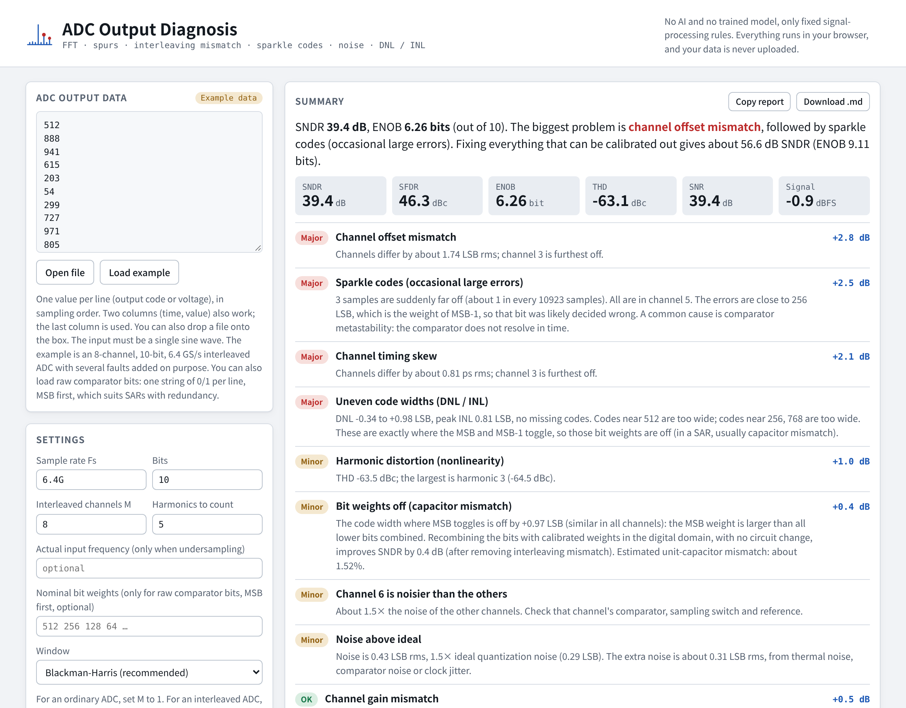
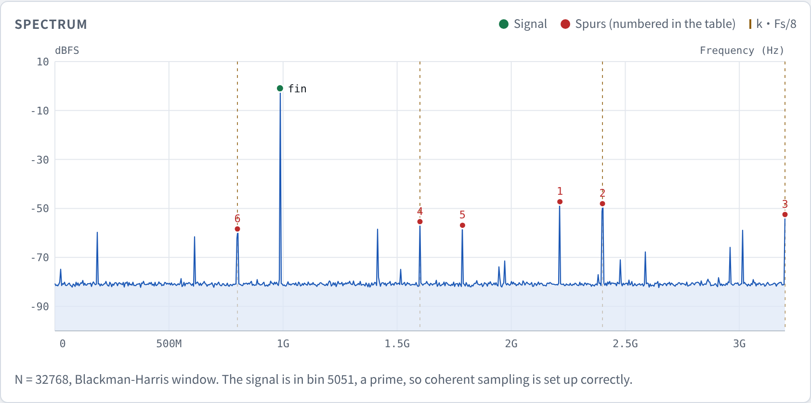
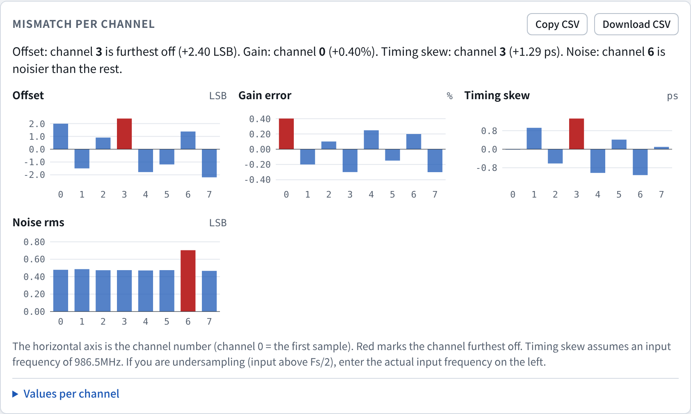
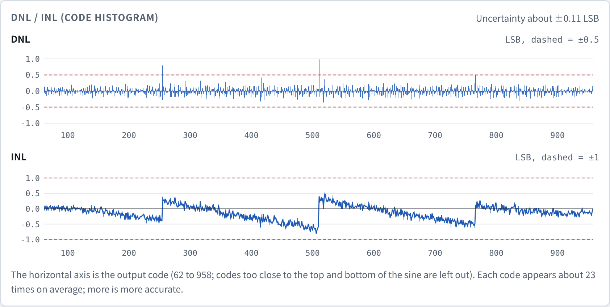
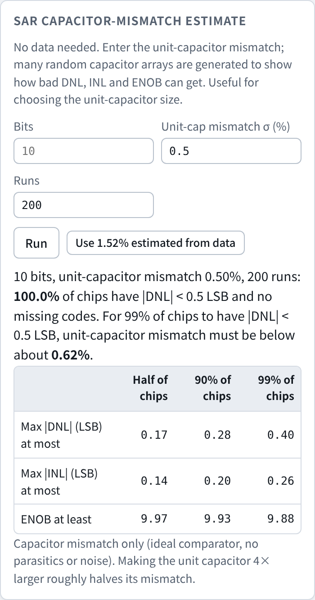

# ADC Output Diagnosis

**Paste your ADC output. Get a diagnosis.**

This tool reads the output of an ADC driven by a sine wave and tells you, in plain words, what is limiting its performance, which problem matters most, and how many dB of SNDR you would gain by fixing each one.



## Supported ADCs

- **Nyquist-rate ADCs:** SAR, pipeline, flash, two-step, cyclic and similar.
- **Time-interleaved ADCs** built from any of these, with any number of channels.
- **SAR ADCs** get two extra checks: bit-weight calibration and a capacitor-mismatch estimate. SARs with redundancy work too, using raw comparator bits.
- **Not supported:** oversampled and noise-shaping ADCs (Σ-Δ, noise-shaping SAR).

The input must be a single-tone sine. Output codes give the full analysis; voltages also work, without DNL / INL.

## Highlights

- **A clear verdict.** Every finding is written in plain language and labeled **Major**, **Minor** or **OK**, most important first. For example: *"3 samples are suddenly far off. All are in channel 5. The errors are close to 256 LSB, which is the weight of MSB-1, so that bit was likely decided wrong."*
- **What to fix first.** Each problem is removed from the data and SNDR is recomputed, so you see how many dB each fix is worth. In the built-in example, offset mismatch is worth +2.8 dB, the sparkle codes +2.5 dB and timing skew +2.1 dB; fixing everything takes SNDR from 39.4 dB to 56.6 dB.
- **No code, no install, no AI.** Open one HTML file in a browser. There is no Python environment to set up, no scripts to write and no AI model behind it. Every result comes from fixed, standard signal-processing rules, so the same data always gives the same answer.
- **Runs inside Cadence Virtuoso.** An optional **ADC Diag** menu samples a finished transient simulation and opens the diagnosis with one click.
- **Your data stays on your computer.** Nothing is uploaded, which matters for confidential designs and foundry data.

## What it finds

- **Harmonic distortion** and the spurs it causes
- **Time-interleaving mismatch**: offset, gain and timing skew of every channel, and which channel is worst
- **Sparkle codes**: occasional large errors, with the channel and the bit that likely caused them
- **Excess noise**: compared with ideal quantization noise, per channel, plus clock phase-noise skirts and 1/f noise
- **DNL / INL and missing codes**, and which bit's capacitor is off
- **SAR bit weights**: the true weight of each bit and the SNDR gain from digital weight calibration
- **SAR capacitor-mismatch estimate** (no data needed): DNL, INL and ENOB spread and yield for a given unit-capacitor mismatch

## Screenshots

**Spectrum with numbered spurs**



**Mismatch per channel** (time-interleaved ADCs)



**DNL / INL from the code histogram**



**SAR capacitor-mismatch estimate** (no data needed)



## Two ways to use it

### 1. In a web browser

Nothing to install. Your data stays on your computer.

- **Online:** open the website link in this repository's **About** section (GitHub Pages).
- **Offline:** download `index.html` and double-click it. It works without an internet connection.

Then:

1. The page opens with an example loaded. Click **Load example** at any time to get it back.
2. Paste your own data into the box, click **Open file**, or drop a file onto the box. To get data out of a simulation, see [Exporting data manually](#exporting-data-manually-without-the-menu).
3. Fill in **Sample rate**, **Bits**, and **Interleaved channels M** (use `1` for an ordinary ADC). The results update right away.

### 2. Inside Cadence Virtuoso

`virtuoso/adc_diag.il` adds an **ADC Diag** menu to the Virtuoso CIW (the main Virtuoso window). After a transient simulation, one click samples the ADC output and opens the analysis in your browser, with no copying or pasting.

**Install (once):**

1. Put this repository in your home directory on the machine that runs Virtuoso:
   ```
   cd ~
   git clone https://github.com/jiefu1-dot/adc-output-diagnosis.git
   ```
   If `git` is not installed, download the ZIP instead:
   ```
   cd ~
   wget https://github.com/jiefu1-dot/adc-output-diagnosis/archive/refs/heads/main.zip
   unzip main.zip
   mv adc-output-diagnosis-main adc-output-diagnosis
   ```
   If the machine has no internet access, use **Code → Download ZIP** on this page and copy the ZIP over.
2. In the CIW, type the line below and press Enter:
   ```
   load("~/adc-output-diagnosis/virtuoso/adc_diag.il")
   ```
3. An **ADC Diag** menu appears in the CIW menu bar. To get it every time Virtuoso starts, add the same line to `~/.cdsinit`.

**Use:**

1. Run a transient simulation of your ADC with a sine input.
2. Choose **ADC Diag → Analyze ADC output...**.
3. Fill in the results directory (psf), the ADC output signal (for example `/TOP/DOUT`), the sample rate, the first sampling time, the number of samples, the number of bits (`0` for voltage data) and the number of interleaved channels. If an ADE session is open, the results directory is filled in for you when possible.
4. Click **OK**. The script samples the waveform, writes a copy of the page with the data built in (to `/tmp` by default), and opens it in Chrome with the analysis already done. The page shows **From Virtuoso** next to the data.

The generated page is a single file, so you can send it to your advisor or teammates and they can open it without Virtuoso.

**Settings** (type in the CIW, before or after loading):

| Variable | Default | Meaning |
|---|---|---|
| `adcDiagBrowser` | `"google-chrome"` | Browser command. If it is not found, Firefox is tried, then `xdg-open`. |
| `adcDiagToolHtml` | `"~/adc-output-diagnosis/index.html"` | Path of the tool page. Change it if you put the repository somewhere else. |
| `adcDiagOutDir` | `"/tmp"` | Where generated pages are written. |

Example: `adcDiagBrowser = "firefox"`

## Input format

- One value per line, in sampling order. Values can be output codes (integers) or voltages.
- Two or more columns per line also work (for example `time, value`). The **last** column is used.
- Lines whose last item is not a number (such as a header row) are skipped.
- Numbers may use SI prefixes, for example `6.4G`, `985.9M`, `10n`.
- **Raw comparator bits** also work: one string of 0/1 per line (for example `1011001010`), MSB first. This suits SARs with redundancy; enter the nominal bit weights in Settings.
- The input must be a **single-tone sine**. Coherent sampling (input frequency = prime × Fs / N) gives the cleanest results.

## Settings

| Setting | Meaning |
|---|---|
| Sample rate Fs | Overall sample rate. Used for frequency labels and for converting timing skew to ps. |
| Bits | ADC resolution. Enables dBFS, LSB units, noise vs. ideal quantization, and DNL / INL. Leave blank for voltage data. |
| Interleaved channels M | `1` for an ordinary ADC. For an interleaved ADC, the number of channels. With 8 phases × 4 sub-ADCs, use `8` to compare phases or `32` to see every sub-ADC. |
| Harmonics to count | Harmonics included in THD (default 5). |
| Actual input frequency | Only needed when undersampling (input above Fs/2), so timing skew is converted correctly. |
| Nominal bit weights | Only for raw-bit input: weights from MSB to LSB, for example `512 256 128 64 32 32 16 8 4 2 1`. Blank means binary. |
| Window | Blackman-Harris is recommended. Use Rectangular only with exact coherent sampling. |

## What it checks

| Check | How it works | What it tells you |
|---|---|---|
| SNDR, SNR, SFDR, THD, ENOB | Windowed FFT. Signal and harmonic bins are summed over the window's main lobe. | Overall dynamic performance. |
| Spur causes | Each large spur is matched against known locations: multiples of fin (folded) → harmonic; k·Fs/M → offset mismatch; k·Fs/M ± fin → gain or timing mismatch. | Why each spur is there. |
| Mismatch per channel | A sine is fitted to each channel's samples (frequency refined by a global fit). DC term = offset, amplitude = gain, phase = sampling instant. | Offset (LSB), gain error (%), and timing skew (ps) of every channel, and which channel is worst. |
| Sparkle codes | The fitted sine is subtracted from every sample. Errors larger than 7× the robust (MAD-based) typical error are flagged. Error sizes close to 2^k LSB are reported as a likely wrong bit decision. | Occasional large errors, typically comparator metastability, and which channel and bit they come from. |
| Noise | Noise floor estimated from the median of noise-only bins, compared with ideal quantization noise (0.29 LSB rms). Floor near the signal and at low frequency is compared with the overall floor. | Excess noise in LSB rms, clock phase-noise skirt, 1/f noise or drift, and per-channel noise for interleaved ADCs. |
| DNL / INL | Sine-wave code histogram (cumulative method). Code-width errors at major transitions (512, 256, 768, ...) are tested as a group. | DNL, INL, missing codes, and which bit weight is off (in a SAR, usually capacitor mismatch). |
| SAR bit weights | For a binary SAR, each binary digit of the output code is one comparator decision. A least-squares fit of the bits together with a sine (and its harmonics, so front-end distortion is not mistaken for weight error) gives the true weight of each bit, per channel for interleaved ADCs. | The code-width error where each bit toggles, which bit's capacitor is off, the SNDR gain from recombining the bits with calibrated weights in the digital domain, and an estimate of unit-capacitor mismatch. |
| Fix estimates | Each problem is subtracted from the data and SNDR is recomputed. | How many dB each fix is worth, so you know what to fix first. |

## SAR capacitor-mismatch estimate

The card in the left column needs no data. Enter the number of bits and the mismatch σ of one unit capacitor (in %). The tool builds many random binary capacitor arrays (each bit's capacitor is made of 2^k unit capacitors with independent mismatch), computes the exact code widths of an ideal-comparator SAR, and reports the spread of max |DNL|, max |INL| and ENOB, the share of chips with |DNL| < 0.5 LSB and no missing codes, and the unit-capacitor mismatch needed for 99% of chips to meet |DNL| < 0.5 LSB. When your data has been analyzed, a button fills in the mismatch estimated from the measured bit weights.

## Reading the results

The **Summary** card lists every finding, labeled **Major**, **Minor**, **OK**, or **Note**, sorted by importance. The dB figure next to a finding is how much SNDR improves if that one problem is fixed. You can copy the summary as Markdown or download it as a `.md` file, and download the per-channel mismatch as CSV.

## Example data

Both files in `examples/` were generated with known faults, so you can check that the tool finds them.

**`examples/ti_adc_8ch_10bit_6p4GSps.txt`**, settings: Fs = `6.4G`, Bits = `10`, M = `8`. This is also the example built into the page.

- 8-channel interleaved 10-bit SAR, 32768 samples, fin ≈ 986.5 MHz
- Offset mismatch up to ±2.4 LSB, gain mismatch up to ±0.4 %, timing skew up to 1.3 ps
- Channel 6 has extra noise (0.6 LSB rms added, versus 0.25 LSB rms in the other channels)
- 3 sparkle codes of about ±256 LSB, all in channel 5
- MSB and MSB-1 capacitor weight errors (+1.6 and +0.6 LSB), which the bit-weight calibration recovers as a +1.0 LSB code-width error at the MSB toggle

**`examples/sar_adc_10bit_100MSps.txt`**, settings: Fs = `100M`, Bits = `10`, M = `1`.

- Ordinary 10-bit SAR, 32768 samples, fin ≈ 9.98 MHz
- MSB weight 1.3 LSB too small, which causes a missing code at 511 (the bit-weight calibration recovers it as −1.3 LSB at the MSB toggle)
- Third-order nonlinearity (HD3 ≈ −55 dBc)
- Clock phase noise, which raises the floor next to the signal
- 0.3 LSB rms of extra noise

## Exporting data manually (without the menu)

If you prefer not to install the menu, `scripts/export_adc_samples.ocn` is an OCEAN script that samples the ADC output of a finished transient run and writes one value per line. Edit the settings at the top (results directory, output net, sample rate, first sampling instant, number of samples), then run it from the CIW and open the output file in the page:

```
load("/path/to/export_adc_samples.ocn")
```

## Limitations

- Needs a single-tone sine input. Two-tone (IMD) tests and ramp-input DNL tests are not supported.
- Oversampled and noise-shaping ADCs (Σ-Δ, noise-shaping SAR) are not supported, because the tool analyzes the full Nyquist band rather than the signal band.
- White clock jitter cannot be separated from other white noise in a single FFT. Measure at two input frequencies: if SNR drops as the input frequency rises, jitter is the cause.
- For interleaved ADCs, each channel needs at least 16 samples (64 or more is better), and the input frequency must not be close to a multiple of Fs/M.
- DNL / INL needs integer output codes and roughly 10 or more samples per code (about 10,000 samples for 10 bits).
- Bit-weight calibration from output codes assumes a plain binary SAR without redundancy. For a redundant SAR, export the raw comparator bits instead.
- The capacitor-mismatch estimate covers capacitor mismatch only: ideal comparator, no parasitics, no noise.
- Spur causes are inferred from spur locations. Treat them as strong hints, and confirm them against your circuit.

## How this was built

This tool was developed with the help of Claude, an AI assistant made by Anthropic, which wrote most of the code. I chose the features and directed the design. Every analysis was tested against example data with known, deliberately added faults (see `examples/`). The tool itself does not use AI when it runs: all results come from fixed signal-processing rules.

## Trademarks

This project is independent and is not affiliated with, endorsed by, or sponsored by Cadence Design Systems, Inc. Cadence, Virtuoso, Spectre and OCEAN are trademarks of Cadence Design Systems, Inc. They are used here only to describe compatibility.

## License

MIT. See [LICENSE](LICENSE).
